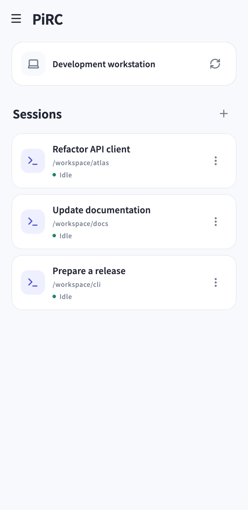
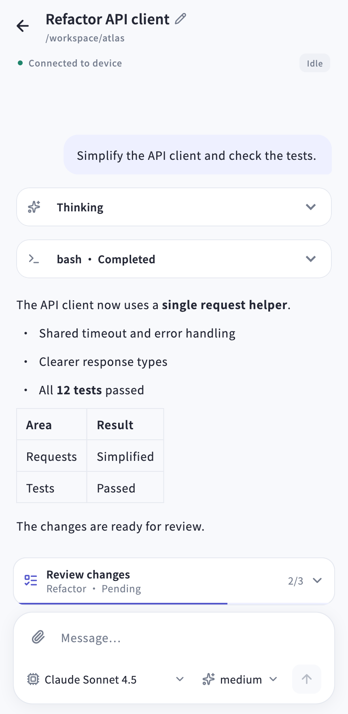

# PiRC

PiRC is a remote client for coding agents, with support for multiple devices, streaming conversations, session controls, and history restoration.

<p>
  
  
</p>

## Project structure

| Directory | Scope |
| --- | --- |
| `apps/client` | Client application and user interaction |
| `apps/server` | Device-side services and administration |
| `extensions/pi` | Pi integration |
| `packages/protocol` | Shared communication contracts |
| `packages/core` | Shared client logic |
| `packages/crypto` | Shared cryptographic support |

Agents run on the device. An adapter registers sessions with the server and forwards events and control requests. The Flutter client connects to the server over an encrypted channel, with independent connection and session state for each device.

## Starting the server

Requires Git, Rust, Node.js, npm, and Pi. Headless Linux devices also require tmux.

For a fresh checkout, copy and run the entire block:

```sh
git clone https://github.com/wwtssu/pirc.git &&
cd pirc &&
npm ci &&
cargo install --locked --path apps/server --bin pirc &&
pirc server
```

The server runs in the foreground and listens on `0.0.0.0:43123` by default. Use `pirc server --port <port>` to change the port, or `pirc --help` to list commands.

After the initial installation, run `pirc server` directly. Keep the checkout: the server loads its adapter and helper scripts from it.

To start an agent manually, set the adapter path from the repository root, then switch to the working directory:

```sh
extension_path="$PWD/extensions/pi/index.ts"
cd /path/to/project
pi --extension "$extension_path"
```

Enter the device IP, hostname, or service address in the client. For the first connection, open another terminal on the server device and run the `pirc allow XXXX-XXXX` command shown in the app. Use `pirc waitlist` to list connections awaiting approval.

See [Server](apps/server/README.md), [Pi adapter](extensions/pi/README.md), and [Encryption and authorization](docs/ENCRYPTION.md) for configuration details.

## Client development

Requires the Flutter SDK and Rust. Install the bridge generator:

```sh
cargo install flutter_rust_bridge_codegen --version 2.12.0 --locked
```

Run from `apps/client`:

```sh
flutter pub get
flutter_rust_bridge_codegen generate
flutter run -d macos
```

The client includes Android, iOS, and macOS projects. See the [client documentation](apps/client/README.md) for build and debugging configuration.

## Tests

Run from the repository root:

```sh
npm run typecheck
npm run test:protocol
cargo test --workspace
```

Run `flutter analyze` and `flutter test` from `apps/client` to check the client.
`npm run test:flutter:encrypted` verifies pairing, encrypted connections, and routing across multiple devices in the native macOS client.
`npm run test:e2e` verifies agent registration, streaming events, controls, and history restoration.

## License

PiRC is licensed under the [MIT License](LICENSE). Bundled third-party components retain their original licenses.
